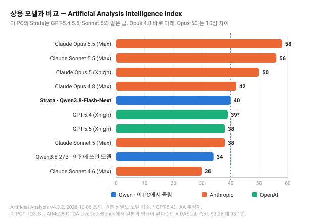

# Strata + Qwen3.8-Flash-Next — RTX 4060 Ti 16GB 측정 기록

| | |
|---|---|
| GPU | NVIDIA GeForce RTX 4060 Ti 16GB (288 GB/s), 드라이버 610.88 |
| CPU / RAM | i9-13900KF (8P + 16E) / DDR5-4800 128GB |
| 디스크 | Samsung 990 PRO 1TB (NVMe) |
| OS | Windows 11 Pro 26200 |
| 엔진 | [Strata](https://github.com/Niko1221/Strata) 0.1.39 (ready-made, CUDA 13.0) |
| 모델 | Qwen3.8-Flash-Next GSQ-RCO **IQ3_S** (125B MoE, 다운로드 83.6GB + MTP 5GB) |
| 측정일 | 2026-10-06 |

[Strata](https://github.com/Niko1221/Strata)는 VRAM에 다 안 들어가는 거대 MoE 모델을 GPU·RAM·CPU·SSD에 나눠
돌리는 추론 엔진이다. 자주 쓰는 expert만 GPU에 두고 나머지는 RAM에서 CPU가 계산한다. 그래서 이 기록에는
지금까지의 "100% GPU 최대 context" 개념이 맞지 않는다. 처음부터 일부를 CPU로 돌리도록 설계된 엔진이다.

## 결론부터

- **지능은 GPT-5.4·GPT-5.5·Claude Sonnet 5와 같은 급이다.** Artificial Analysis 지수 40으로 GPT-5.4(39)·GPT-5.5(38)·Sonnet 5(38) 바로 위, Opus 4.8(42) 바로 아래. Opus 5(50)와는 10점, Opus 5.5(58)와는 18점 차이.
- **같은 PC에서 쓰던 27B보다 6점 높다**(34 → 40). 생성 속도는 오히려 더 빠르다.
- **thinking은 medium으로 써야 한다.** 기본값 high는 8/10에 문제당 208초, medium은 10/10에 22초다.
- 속도는 생성 **32~34 tok/s**, 32K 프롬프트 처리 **1,278 tok/s**(expert 캐시가 데워진 뒤).

## 상용 모델과 비교



[Artificial Analysis](https://artificialanalysis.ai/models/qwen3-8-flash-next) Intelligence Index **v4.3.2**,
2026-10-06 조회. 한 기관이 같은 방법으로 잰 값만 썼다. 제조사 자체 발표는 하네스와 문제 세트가 제각각이라
섞지 않았다(예: SWE-bench Pro가 Qwen 발표로는 62.5, 다른 곳에선 Opus 5.5가 89.9인데 둘은 같은 시험이 아니다).

| 모델 | 지수 | Terminal-Bench 4.0 | HLE | SciCode | CritPt | AA-Omniscience | AutomationBench | AA-LCR |
|---|---|---|---|---|---|---|---|---|
| Claude Opus 5.5 (Max) | **58** | 60% | 61% | 67% | 32% | 46 | 70% | 85% |
| Claude Sonnet 5.5 (Max) | 56 | | | | | | | |
| Claude Opus 5 (Xhigh) | 50 | 46% | 54% | 56% | 28% | 35 | 53% | 80% |
| Claude Opus 4.8 (Max) | 42 | 22% | 49% | 54% | 21% | 29 | 46% | 78% |
| **Strata · Qwen3.8-Flash-Next** | **40** | **25%** | **38%** | **51%** | **11%** | **−10** | **56%** | **80%** |
| GPT-5.4 (Xhigh) | 39* | | 44% | | 23% | 6 | | 82% |
| GPT-5.5 (Xhigh) | 38 | 15% | 46% | 56% | 27% | 21 | 47% | 84% |
| Claude Sonnet 5 (Max) | 38 | 14% | 41% | 54% | 17% | 16 | 37% | 82% |
| Qwen3.8-27B (Xhigh) · 이 PC의 이전 모델 | 34 | 6% | 34% | 47% | 5% | −10 | 48% | 82% |
| Claude Sonnet 4.6 (Max) | 30 | 3% | 34% | 50% | 3% | 12 | 20% | 80% |

\* GPT-5.4는 AA가 추정치로 표시한 값이다. 빈칸은 비교 페이지에 값이 없었던 항목.

### 그래서 어느 급인가

괄호는 상대 모델 점수에서 Strata(40)를 뺀 값이다.

| Strata는 | |
|---|---|
| **확실히 위** | Claude Sonnet 4.6 (−10) |
| **같은 급** (±2, 측정 오차 범위) | GPT-5.4 (−1), GPT-5.5 (−2), Claude Sonnet 5 (−2) |
| **근소하게 아래** | Claude Opus 4.8 (+2) |
| **확실히 아래** | Claude Opus 5 (+10), Claude Sonnet 5.5 (+16), Claude Opus 5.5 (+18) |

OpenAI 기준으로는 **GPT-5.4~5.5 급**이다. GPT-5.5 이상 GPT-5.6 미만이라고 말할 근거는 없다. 1~2점 차이는 AA
지수에서 갈라 말할 만한 크기가 아니다.

Anthropic 기준으로는 **Sonnet 5 이상, Opus 4.8 미만**이다. 참고로 "Claude Sonnet 4.8"은 AA에 없다. Sonnet은
4.6 다음이 5다. Opus 4.8이나 Sonnet 4.6을 말한 거라면 위 표에 둘 다 있다.

### 점수 모양이 상용 모델과 다르다

총점은 비슷해도 잘하는 것과 못하는 것이 뚜렷하게 갈린다.

- **사무·에이전트 작업은 오히려 위다.** AutomationBench 56%로 GPT-5.5(47%), Sonnet 5(37%), Opus 4.8(46%)보다 높다. Terminal-Bench 4.0도 25%로 GPT-5.5(15%)·Sonnet 5(14%)의 1.7~1.8배다. 코딩 에이전트로 쓰기엔 좋은 신호다.
- **지식 신뢰도가 크게 처진다.** AA-Omniscience −10은 모르는 걸 모른다고 하지 않고 지어낸다는 뜻이다. 상용 모델은 전부 양수다(GPT-5.5 21, Opus 4.8 29). 사실 확인이 중요한 질문에는 답을 그대로 믿으면 안 된다. 같은 계열인 27B도 −10이라 Qwen 계열의 성향으로 보인다.
- **최상위 난제는 약하다.** CritPt(최전선 물리) 11%, HLE 38%로 GPT-5.5(27%, 46%)에 못 미친다.

### 이 PC의 IQ3_S가 원본과 같은가

AA가 잰 건 원본 정밀도 모델이고, 이 PC에서 돌리는 건 3.5비트로 줄인 IQ3_S다. 양자화를 만든
[ISTA-DASLab의 측정](https://huggingface.co/ISTA-DASLab/Qwen3.8-Flash-Next-GSQ-RCO-GGUF)으로는 차이가 오차 범위 안이다.

| | BF16 원본 (354GB) | IQ3_S (83.6GB) |
|---|---|---|
| AIME25 | 100.00 | 100.00 |
| GPQA-Diamond | 91.92 | 92.93 |
| LiveCodeBench v6 | 87.43 | 86.86 |
| 평균 | 93.12 | 93.26 |

그래서 위 AA 점수를 이 PC에 그대로 가져와도 된다고 봤다. 다만 이 비교에는 에이전트형 과제가 없다.
Terminal-Bench 같은 항목까지 같다는 근거는 아직 없다.

## 속도

`bench/speed_openai.py`. Strata README와 같은 방식이다. 길이마다 코드 프롬프트 하나, 256토큰 생성, MTP 켬,
thinking 끔.

| 프롬프트 | 프롬프트 처리 | 생성 | MTP 적중 |
|---|---|---|---|
| 1K | 271 tok/s | 32.8 tok/s | 70% |
| 4K | 793 tok/s | 31.4 tok/s | 86% |
| 32K | **1,278 tok/s** | 32.5 tok/s | 73% |
| 64K (context 꽉 참) | **1,455 tok/s** | 33.6 tok/s | 78% |

생성 속도가 context 길이와 상관없이 평평하다. KV cache를 RAM에 두는 스트리밍 모드라서 그렇다.

### 켜자마자는 느리다

위 표는 코딩 벤치를 한참 돌린 뒤 잰 값이다. 서버를 띄우자마자 재면 이렇게 나온다.

| 프롬프트 | 프롬프트 처리 (직후 → 데워진 뒤) | 생성 (직후 → 데워진 뒤) |
|---|---|---|
| 1K | 226 → 271 | 21.3 → 32.8 |
| 4K | 540 → 793 | 23.9 → 31.4 |
| 32K | 708 → 1,278 | 20.5 → 32.5 |
| 64K | 735 → 1,455 | 19.4 → 33.6 |

차이는 GPU에 올라간 expert 캐시의 적중률이다. 기동 직후 31%에서 쓰다 보면 65%까지 오른다. 처음 몇 분 써보고
"느리다"고 판단하면 안 된다.

### 다른 데와 비교하면

| | 생성 | 32K 프롬프트 처리 |
|---|---|---|
| 이 PC · Strata IQ3_S (125B MoE) | 32.5 tok/s | 1,278 tok/s |
| RTX 5070 12GB · Strata IQ3_S (Strata 공식) | 53 tok/s | 1,620 tok/s |
| 이 PC · Ollama Qwen3.8-27B IQ3_S | 20.6 tok/s | 251~263 tok/s (짧은 프롬프트) |

RTX 5070의 60~80%다. 메모리 대역폭이 288 대 672GB/s인 것과, 데스크톱이 VRAM을 4GB쯤 먹어 GPU에 올라가는
expert가 줄어든 게 겹쳤다.

눈여겨볼 건 아래 줄이다. 이 PC에서 쓰던 27B보다 **모델은 4.6배 큰데 생성은 1.6배 빠르다.** MoE라 토큰마다
실제로 계산하는 파라미터가 적어서다. 프롬프트 처리도 27B가 짧은 프롬프트에서 낸 값의 5배인데, 27B를 32K로
잰 적은 없어서 같은 길이끼리의 비교는 아니다. Strata는 긴 프롬프트를 8,192토큰씩 묶어 읽어 길수록 빨라진다.

## 코딩 10문제

`bench/run.py`에 OpenAI 호환 모드를 붙여 같은 문제를 돌렸다(`API=openai`). 모델이 낸 코드를 실제로 실행해 숨긴
테스트로 채점한다. 큰 추론 모델이라 토큰 한도를 16,384로 올렸다(27B 때는 4,096).

| thinking | 통과 | 문제당 평균 | 전체 |
|---|---|---|---|
| high (Strata 기본값) | 8 / 10 | 208초 | 2,083초 |
| **medium** | **10 / 10** | **22초** | **221초** |
| off | 10 / 10 | 7초 | 74초 |

| 문제 | high | medium | off |
|---|---|---|---|
| LRU 캐시 | PASS 25초 · 502tok | PASS 16초 · 471tok | PASS 5초 · 166tok |
| 최장 유효 괄호 | PASS 16초 · 273tok | PASS 16초 · 551tok | PASS 4초 · 101tok |
| 두 정렬배열 중앙값 O(log) | PASS 106초 · 2,222tok | PASS 17초 · 591tok | PASS 8초 · 321tok |
| 정수 계산기 파서 | **잘림** 794초 · 16,384tok | PASS 39초 · 1,362tok | PASS 11초 · 422tok |
| 이진트리 직렬화 | PASS 32초 · 646tok | PASS 18초 · 595tok | PASS 8초 · 315tok |
| k회 주식거래 DP | **잘림** 629초 · 16,384tok | PASS 38초 · 1,475tok | PASS 13초 · 460tok |
| 정규식 매칭 | PASS 37초 · 1,244tok | PASS 17초 · 602tok | PASS 7초 · 266tok |
| 위상정렬 | PASS 30초 · 891tok | PASS 21초 · 678tok | PASS 8초 · 229tok |
| word break 전체해 | PASS 392초 · 12,471tok | PASS 26초 · 893tok | PASS 5초 · 176tok |
| 스레드 안전 RateLimiter | PASS 22초 · 666tok | PASS 12초 · 359tok | PASS 5초 · 150tok |

### high에서 잘린 두 문제

둘 다 같은 말을 되풀이한 루프가 아니었다. thinking 원문을 줄 단위로 세보면 이렇다.

| | thinking 길이 | 중복된 줄 | 마지막 1/4 중 앞에서 나온 줄 | 답변 |
|---|---|---|---|---|
| 정수 계산기 파서 | 58,664자 | 1% | 0% | 0자 |
| k회 주식거래 DP | 53,490자 | 12% | 15% | 0자 |

계산기 파서는 함수 정의 순서와 이름 조회 시점 같은 세부를 끝없이 새로 검증하다 답을 못 냈다. 주식거래는
단순 DP(O(nk))로 충분한 문제에 힙과 연결 리스트로 구간을 병합하는 O(n log k) 알고리즘을 설계하다 한도에
걸렸다. 지나치게 꼼꼼하고, 지나치게 큰 걸 짓는다.

같은 계산기 파서 문제가 4080과 4060 Ti의 27B IQ4_XS에서도 thinking이 끝나지 않아 실패했다. 모델이 4.6배
커져도 그대로 나왔으니 Qwen3.8 계열이 이 문제에서 보이는 성향이다.

### 그래서 medium

medium은 같은 두 문제를 39초와 38초에 풀었다. 이 10문제에서는 thinking을 줄일수록 빠르고 점수도 같거나 높았다.
문제 10개에 설정당 1회라 "medium이 high보다 똑똑하다"까지는 말할 수 없다. 말할 수 있는 건 **이 PC 속도에서
high는 실사용하기엔 너무 오래 생각한다**는 것까지다.

Strata의 공유 설정 파일(`strata-iq3_s.shared-settings.json`)에 `reasoning_effort: medium`을 넣어뒀다.
요청에 강도를 안 실어 보내는 앱(Open WebUI 등)은 medium을 받고, 강도를 직접 지정하는 앱은 자기 값을 쓴다.

## OpenCode + Superpowers

`~/.config/opencode/opencode.json`에 provider를 하나 추가했다. Superpowers는 전역 플러그인이라 모델을 바꿔도
그대로 붙는다.

```json
"strata": {
  "npm": "@ai-sdk/openai-compatible",
  "name": "Strata (local)",
  "options": { "baseURL": "http://127.0.0.1:8080/v1", "apiKey": "strata" },
  "models": {
    "qwen3.8-flash-next": {
      "name": "Qwen3.8-Flash-Next IQ3_S 64k (Strata)",
      "reasoning": true,
      "limit": { "context": 65536, "output": 32768 }
    }
  }
}
```

`model`과 `small_model`을 둘 다 `strata/qwen3.8-flash-next`로 바꿨다. `small_model`(제목·요약용)을 Ollama에
남겨두면 OpenCode가 Ollama 모델을 VRAM에 따로 올려 Strata와 GPU를 다툰다.

지난번 27B 때와 같은 과제를 시켰다. "TDD로 calc.py에 divide(a, b)를 추가해라, b가 0이면 ValueError."

| 시간 | 동작 | 결과 |
|---|---|---|
| 24초 | `test-driven-development` 스킬을 스스로 로드 | |
| 54초 | `test_divide`부터 작성하고 실행 | **RED** (divide 없음) |
| 67초 | divide 최소 구현 후 실행 | **GREEN** |
| 82초 | 0으로 나누기 테스트를 따로 추가하고 실행 | **RED** (ValueError가 아니라 ZeroDivisionError) |
| 96초 | 0 검사를 넣고 실행 | **GREEN** |
| 101초 | 전체 테스트 다시 실행 | OK, 3개 통과 |

지시하지 않았는데 스킬을 불러 RED→GREEN을 두 바퀴 돌렸다. 27B는 한 바퀴였다. 엣지 케이스를 별도 사이클로
떼어낸 게 차이다. 112초가 걸렸다.

## Open WebUI (Tailscale)

(작성 중)

## 설치 중에 걸렸던 것

**Ollama가 VRAM을 영원히 붙잡고 있었다.** `OLLAMA_KEEP_ALIVE=-1`이라 Ollama 모델을 한 번 쓰면 13GB가 계속
남았다. Strata는 기동할 때 남은 VRAM에 맞춰 expert를 GPU에 올리니 이러면 훨씬 느려진다. `10m`으로 바꿨다.
안 쓰면 10분 뒤 비운다.

**Docker 안의 Open WebUI가 Strata에 막혔다.** Strata는 키 없이 돌 때 DNS 리바인딩을 막으려고 `Host` 헤더가
localhost가 아니면 거부한다. `host.docker.internal`로 들어오는 요청도 걸렸다. 설정의 `allowed_hosts`에
`host.docker.internal`을 넣어 풀었다. 이 이름은 Docker가 로컬에서 정하는 이름이라 외부 사이트가 리바인딩에 쓸
수 없다. 다른 이름은 여전히 막히는 걸 확인했다.

참고로 Docker Desktop은 `host.docker.internal`로 오는 연결을 호스트의 `127.0.0.1`로 넘겨준다. 그래서 Strata를
`0.0.0.0`으로 열거나 방화벽을 건드릴 필요가 없었다. 직접 확인했다(임시 서버를 127.0.0.1에만 띄우고 컨테이너에서
호출 → HTTP 200).

**Git Bash에서 curl로 한국어를 보내면 깨진다.** Windows 콘솔 코드페이지(CP949)로 넘어가 Strata가
`'utf-8' codec can't decode`로 거부했다. Strata 문제가 아니다. Python이나 PowerShell로 UTF-8로 보내면 된다.

**RAM은 처음에 빠듯했다.** 128GB 중 Docker와 VM 때문에 쓸 수 있는 게 61GB였고, IQ3_S는 Strata 추정으로 약 62GB가
필요했다. 안 쓰는 Hyper-V VM 하나와 브라우저 창을 정리해 73GB를 만들고 올렸다. 올린 뒤 Strata 프로세스는 작업
메모리 50GB, 커밋 61GB를 쓰고 사용 가능 RAM은 29GB가 남았다.

## 안 해본 것

- 이미지 입력. 설치 때 끄고 올렸다(VRAM 1.4GB를 비워둬야 해서 텍스트가 몇 % 느려진다).
- Unsloth UD-IQ4_XS(~4비트, 94GB). RAM 여유가 더 있어야 한다.
- `START-HERE.bat --calibrate`. 이 PC에 맞는 엔진 설정을 5~10분 재서 고른다. 해보면 몇 % 더 나올 수 있다.
- AA 항목 중 에이전트형 과제의 로컬 재현. 이 PC의 IQ3_S로 Terminal-Bench 같은 걸 직접 돌려보진 않았다.
- 같은 설정 반복 측정. 코딩 벤치는 설정당 1회다.
